<h1>
  Hi, I'm Asad Ali!
  
</h1>

<p>
  <em>Rust backend &amp; systems engineer from Pakistan</em>
  
</p>

<p>
  <em>I design backends and scalable systems: fast, reliable, and built to grow.</em>
</p>

<p>
  💼 <strong>Open to remote Rust / backend roles</strong>, full-time or contract
</p>

<hr />

<h3>
  
  A little more about me...
</h3>

```rust
let aeon = Engineer {
    name: "Asad Ali",
    from: "Pakistan 🇵🇰",
    speaks: vec!["Urdu", "English", "Rust"],
    role: "backend & systems",
    loves: vec!["system design", "APIs", "databases", "performance", "scaling"],
    stack: Stack {
        lang: vec!["Rust"],
        backend: vec!["Axum", "Tokio", "AWS Lambda"],
        data: vec!["SurrealDB", "redb"],
        also: vec!["GPUI", "Leptos", "Docker"],
    },
    now: "a shared auth service in Axum for multiple apps",
    looking_for: "a remote Rust backend team to grow with",
    motto: "if it compiles, it ships 🦀",
};
```

<hr />

<h3>
  
  Projects
</h3>

#### 🧾 Scan & Fill

```rust
let scan_fill = Project {
    name: "Scan & Fill",
    what: "scan a bill's barcode, and it gets typed into payment software for you",
    platform: "Windows desktop",
    tech: vec!["Rust", "GPUI", "redb", "Tokio", "Win32 API", "WiX"],
    architecture: Workspace {
        client: "GPUI app: screens, pages, state, local database",
        shared: "bill formats and barcode parsing, UI-free",
        win_ops: "Win32 layer: keyboard hooks, focus tracking, typing",
    },
    features: vec![
        "live scanning with a global trigger key",
        "bulk mode: scan many bills, type them all in one run",
        "detects which app is focused before typing",
        "data-driven bill formats and software profiles",
        "single instance, crash hook, MSI installer",
    ],
    challenges: vec![
        "typing into other apps reliably with SendInput",
        "global keyboard hooks without blocking the UI thread",
        "keeping the UI responsive while a run is typing",
    ],
};
```

#### 🐳 [Aeon Server Explorer](https://github.com/aeonroamer/aeon-server-explorer)

```rust
let server_explorer = Project {
    name: "Aeon Server Explorer",
    what: "a self-hosted web UI for running Docker on your own server",
    platform: "Web, Linux server (reached over an SSH tunnel)",
    tech: vec!["Rust", "Leptos (SSR + WASM)", "Axum", "Tokio", "bollard", "SurrealDB", "SSE"],
    architecture: Workspace {
        app: "Leptos pages, server functions, guards, live streams",
        backend: "SurrealDB, Docker engine, stacks on disk, Docker Hub",
        shared: "types and validation used by server and browser",
    },
    features: vec![
        "live logs and CPU/RAM for every container",
        "build compose stacks from a form, then Save & deploy",
        "Docker Hub search, pulls and image uploads with live progress",
        "file browser for volumes through sandboxed helper containers",
        "append-only audit log of every change",
    ],
    challenges: vec![
        "streaming Docker output to the browser and stopping when it leaves",
        "locking it down: loopback only, DNS-rebinding guard, Argon2id, hashed sessions",
        "page refreshes every 5 s without wiping a form you're typing in",
    ],
};
```

#### 🗄️ [sudm](https://github.com/aeonroamer/sudm)

```rust
let sudm = Project {
    name: "sudm",
    what: "an async CLI that syncs local .surql files with a live SurrealDB",
    platform: "Cross-platform CLI",
    tech: vec!["Rust", "Tokio", "Clap", "SurrealDB SDK"],
    features: vec![
        "scaffolds schema, function and event folders",
        "auto-provisions the namespace and database if missing",
        "applies definitions in order using idempotent upserts",
        "connects over ws, wss, http or https",
    ],
    challenges: vec![
        "declarative sync with no migration state table",
        "keeping schema, functions and events in a safe apply order",
    ],
};
```
